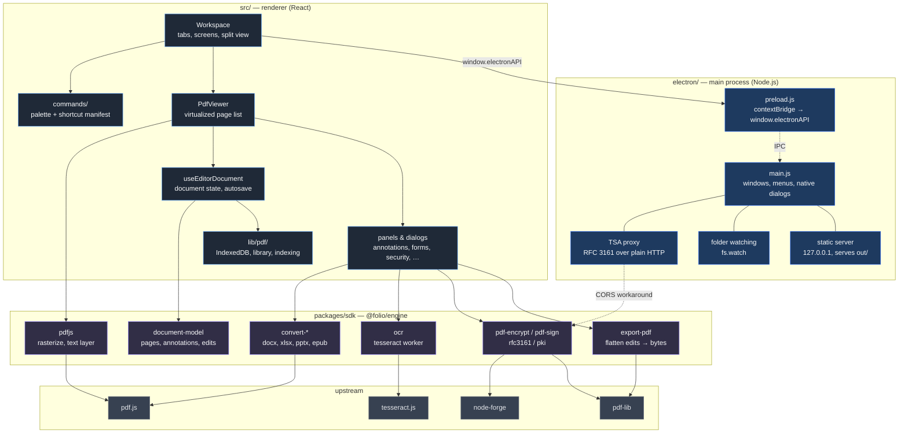

# Architecture

Folio is one repository with three layers. The boundary that matters most is between the **interface** and the **engine**: all PDF logic lives in `packages/sdk` and has no knowledge of React, the DOM, or Electron.

```
electron/         Desktop shell     Node.js main process
src/              Interface         Next.js 16 + React 19
packages/sdk/     Engine            @folio/engine — pure TypeScript
```

## Overview



## Why the engine is separate

Everything that manipulates a PDF — parsing, rendering, editing, encryption, signing, OCR, conversion — lives in `packages/sdk` behind a typed API. Components call into it; they never import `pdf-lib` or `pdfjs-dist` directly.

This costs a little indirection and buys three things:

1. **The logic is testable without a browser.** `npm test` in the SDK typechecks, builds, and runs smoke tests in both Node and a headless browser, with no React involved.
2. **The hard parts are reusable.** A correct AES-256 R6 implementation or a working RFC 3161 timestamp embedder is worth more as a package than as application internals.
3. **The interface stays replaceable.** The engine has no opinion about how a document is displayed.

The one deliberate exception is `src/lib/pdf/`, which holds concerns that genuinely require the browser: IndexedDB storage, the library index, autosave, and folder watching.

## The rendering pipeline

Opening a document runs roughly this path:

```
File → ArrayBuffer → loadPdfDocument() → PdfDocumentModel
                                              ↓
                              virtualized page list (PdfViewer)
                                              ↓
                     IntersectionObserver decides what is near the viewport
                                              ↓
                  PdfPageCanvas renders → <canvas> + text layer + overlays
```

Three properties are worth knowing about:

**Pages render lazily and are released again.** An `IntersectionObserver` mounts a page's canvas as it approaches the viewport, and frees the rendered bitmap once it has scrolled well clear. Memory use is a function of viewport size, not document length.

**A rendered page is three stacked layers.** The canvas raster underneath, pdf.js's text layer above it (which is what makes selection and search highlighting work), then the annotation and form-field overlays. Annotations are React state drawn in DOM coordinates, not baked into the raster — which is why they stay editable and only get flattened at export.

**Edits are never applied in place.** `useEditorDocument` keeps the original bytes plus a list of edits. Export replays them through `pdf-lib` to produce new bytes. Text editing works by covering the original glyphs with a positioned replacement rather than rewriting content streams, which is what keeps it a single-pass, non-reflowing operation.

## Storage

Everything is local. There is no server, no account, and no upload. State lives in IndexedDB under a single database with these stores:

| Store | Holds |
| --- | --- |
| `library` | Document entries — name, size, tags, thumbnail, page count |
| `libpagetext` | Extracted per-page text, used for snippets |
| `libwordindex` | Inverted index: word → document IDs |
| `collections`, `smartfolders`, `savedsearches` | Library organization |
| `versions` | Version history |
| `autosave` | Periodic snapshots of in-progress edits |
| `auditlog` | Document activity and signature trail |
| `certificates`, `signingplans` | Signing identities and multi-party plans |
| `plugins` | Plugin source (functions can't survive a round trip, so source is re-evaluated on load) |

Search is two-tier. The inverted index narrows the whole library to documents containing every query word — set intersection over document-ID arrays, which is cheap. Only those candidates then get their cached page text scanned for an actual match and snippet. Indexing happens in the background one document at a time, yielding between each so it never competes with interactive work.

## The Electron shell

The main process handles only what the renderer cannot:

- **Native dialogs** for opening and saving files
- **Window management**, including multiple windows
- **Folder watching** via `fs.watch`, which feeds new arrivals into the library headlessly
- **RFC 3161 timestamp requests**, because TSA servers generally don't send CORS headers — they were never designed to be called from a browser page, so requests are proxied as plain Node HTTP

The renderer runs with `contextIsolation: true` and `nodeIntegration: false`. `preload.js` exposes a narrow, explicit API on `window.electronAPI`; there is no direct Node access from the page.

In production the shell doesn't load from the filesystem. `next build` with `output: "export"` produces a static bundle, and the main process serves it over a loopback HTTP server on a random port. This keeps the app on an `http://` origin so browser APIs that reject `file://` — IndexedDB, workers, module scripts — behave the same as they do in development.

## Build targets

| Command | Produces |
| --- | --- |
| `npm run dev` | Next dev server, browser only |
| `npm run electron:dev` | Next dev server plus the Electron shell |
| `npm run build` | Standard Next.js build |
| `npm run electron:build` | Static export, then electron-builder installers |

`next.config.ts` switches on `ELECTRON_BUILD`, enabling `output: "export"` and unoptimized images only for desktop builds. The browser build keeps the normal Next.js pipeline.

## Things to know before changing this

**Dynamic imports are load-bearing.** Several modules pull in `pdfjs-dist`, which touches browser globals at import time. Those are imported dynamically (`import("...")` inside an effect) rather than at the top level, so they don't break server rendering. Moving one to a static import will surface as an SSR crash.

**Hydration.** `Workspace` is not SSR-excluded, so anything branching on `window.electronAPI` during render would make the server and client disagree. `useIsElectron()` exists for this: it returns `false` on the first render and flips in an effect.

**Encryption requires classic cross-reference tables.** `pdf-encrypt.ts` must run on a document saved with `useObjectStreams: false`, so that nothing has to reason about whether an xref stream or compressed object stream should itself be excluded from encryption.

**Signing patches bytes in place.** Signatures reserve a fixed-size `/Contents` placeholder, hash everything around it, then write the real DER back without shifting a single offset. Anything that rewrites the file after signing invalidates the signature.
