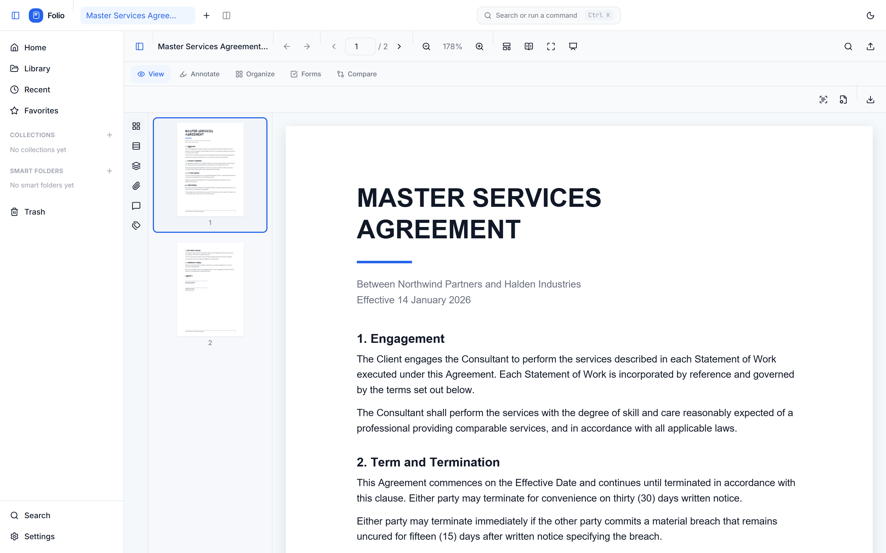

<div align="center">

# Folio

**The modern document workspace.**

Read, edit, annotate, organize and sign documents — without the weight of legacy PDF software.

[Download for Windows](https://github.com/naledisandamela/folio/releases/latest) ·
[Documentation](https://github.com/naledisandamela/folio/tree/main/docs) ·
[Architecture](ARCHITECTURE.md) ·
[Contributing](CONTRIBUTING.md) ·
[Roadmap](#roadmap)

[](LICENSE)
[](packages/sdk/LICENSE)
[](#platforms)

<picture>
  <source media="(prefers-color-scheme: dark)" srcset="docs/assets/screenshot-workspace-dark.png">
  
</picture>

</div>

---

## Why Folio

Most PDF tools fall into one of two camps. Either they are fast but can only read, or they can do everything and take twenty seconds to launch behind a subscription wall.

Folio is an attempt at the third option: a document workspace that starts instantly, stays out of the way, and still handles the things people actually need a "real" PDF application for — filling and building forms, redaction, OCR, encryption, and cryptographic signatures.

Three things shape every decision in this codebase:

- **Speed is a feature.** Pages render lazily and off-screen bitmaps are released as you scroll, so a 1,000-page document costs about as much memory as a 10-page one. Search runs against a background-built inverted index rather than re-scanning documents on every keystroke.
- **The document is the interface.** No ribbons, no floating palettes. Tools appear when the mode calls for them, and everything is reachable from the command palette (<kbd>Ctrl/⌘</kbd>+<kbd>K</kbd>).
- **Your files stay yours.** Folio does all of its work locally. There is no account, no telemetry, and no upload step. Documents and the search index live in IndexedDB on your own machine.

## Features

**Reading and navigation**
Multi-tab and split view · continuous or single-page scroll · reading mode · outline and bookmarks · thumbnails · page rotation · zoom presets and fit-to-width · navigation history · full-text search across the whole library

**Annotation and markup**
Highlight, underline, strikeout, squiggly · freehand ink · shapes and arrows · sticky notes and text boxes · stamps · measurement tools · a threaded comments panel with @mentions

**Editing**
Edit existing text in place · insert and replace images · reorder, rotate, insert and delete pages · merge and split documents · watermarks, headers, page numbers · compress · compare two pages visually · near-duplicate detection across the library

**Forms**
Fill AcroForm fields · build new fields (text, checkbox, radio, dropdown) · calculation, validation and format rules emitted as standard Acrobat core-JS actions · import and export form data

**Security and signing**
Password encryption (AES-128 R4 and AES-256 R6) · permission flags · redaction with real content removal · metadata and XMP scrubbing · certificate-based digital signatures (detached PKCS#7, ISO 32000-1 §12.8) · RFC 3161 trusted timestamps · bulk and sequential multi-party signing · an audit trail

**Conversion and OCR**
Export to DOCX, XLSX, PPTX, EPUB and SVG · OCR scanned pages with automatic deskew and preprocessing · barcode and QR scanning

**Library**
Tags, collections and favorites · smart folders · saved searches · a query language (`tag:contract -tag:draft "signed copy"`) · watched folders for auto-import · version history · autosave with crash recovery

**Accessibility**
Keyboard navigation throughout · screen-reader tags panel · adjustable font scaling · reduced-motion mode · high-contrast-aware theming

**Extensibility**
A plugin runtime for adding commands to the palette, and [`@folio/engine`](packages/sdk) — the document engine as a standalone, framework-agnostic package.

## Installation

### Download a build

Grab the latest Windows installer from the [releases page](https://github.com/naledisandamela/folio/releases/latest).

| Platform | Status | Notes |
| --- | --- | --- |
| Windows | `Folio-Setup-<version>.exe` | Windows 10 and later, 64-bit |
| macOS | Build from source | Installer planned |
| Linux | Build from source | AppImage and Flatpak planned |

The installer is not code-signed yet, so Windows SmartScreen will warn that the publisher is unknown. Choose **More info → Run anyway**, or build from source if you would rather run code you have read.

### Build from source

Requires **Node.js 20.9+**.

```bash
git clone https://github.com/naledisandamela/folio.git
cd folio
npm install

npm run electron:dev     # desktop app with hot reload
npm run dev              # browser only, at http://localhost:3000
```

To produce a distributable:

```bash
npm run electron:installer:win   # Windows NSIS installer
npm run electron:build           # installer for the current platform
```

Artifacts are written to `../PDF-electron-dist`.

## Platforms

Folio is an Electron desktop application. Windows installers are published; macOS and Linux run from source today, and the same interface runs in a browser for development. The rendering, editing and signing work happens in [`@folio/engine`](packages/sdk), which has no DOM or Electron dependency and is designed to be used on its own. It ships from this repository and will be published to npm alongside the first tagged release:

```ts
import { loadPdfDocument, exportPdf } from "@folio/engine";
import { signPdf } from "@folio/engine/signing";
import { recognizePage } from "@folio/engine/ocr";
```

## Roadmap

**Shipped**

- [x] Rendering, annotation, page organization and export
- [x] AcroForm filling and form building
- [x] AES-128 and AES-256 encryption, permissions, redaction
- [x] Certificate signing with RFC 3161 timestamps
- [x] OCR with deskew, barcode scanning
- [x] Library with inverted-index search, tags, collections, smart folders
- [x] Plugin runtime and command palette

**Planned**

- [ ] Signed and notarized installers for all three platforms
- [ ] Linux Flatpak and distribution packages
- [ ] Incremental save (append-only updates rather than full rewrites)
- [ ] PDF/A and PDF/UA conformance checking and conversion
- [ ] ICC-aware color management for print
- [ ] Tagged-PDF authoring, not just inspection
- [ ] Arabic contextual shaping in text export
- [ ] A published plugin API with versioning guarantees

See [CHANGELOG.md](CHANGELOG.md) for released versions.

## Contributing

Contributions are welcome. [CONTRIBUTING.md](CONTRIBUTING.md) covers the development setup, the layout of the codebase, and what makes a change easy to review. Issues labelled [`good first issue`](https://github.com/naledisandamela/folio/labels/good%20first%20issue) are a reasonable place to start.

Please read the [Code of Conduct](CODE_OF_CONDUCT.md) before taking part, and [SECURITY.md](SECURITY.md) if you have found a vulnerability — please don't open a public issue for those.

## Architecture

Folio is one repository with three layers: an Electron shell, a Next.js/React interface, and a framework-agnostic document engine that holds all of the PDF logic.

```
electron/        Desktop shell — windows, native file dialogs, TSA proxying
src/             React interface — viewer, panels, dialogs, library
packages/sdk/    @folio/engine — rendering, editing, OCR, signing, conversion
```

[ARCHITECTURE.md](ARCHITECTURE.md) has the full picture, including the rendering pipeline, the storage layer, and why the engine is separated from the interface.

## License

The Folio application is licensed under the [GNU General Public License v3.0](LICENSE).

The document engine, [`@folio/engine`](packages/sdk), is licensed separately under the [Apache License 2.0](packages/sdk/LICENSE) so it can be embedded in other projects regardless of their license.

Folio builds on [pdf.js](https://mozilla.github.io/pdf.js/), [pdf-lib](https://pdf-lib.js.org/), [Tesseract.js](https://tesseract.projectnaptha.com/) and [node-forge](https://github.com/digitalbazaar/forge).
